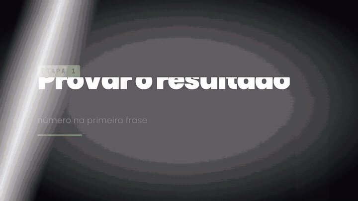
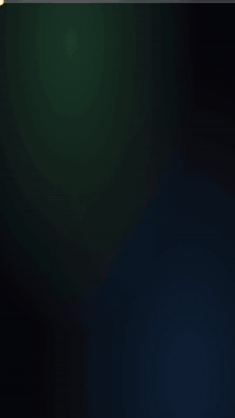

# 🎬 Pack de Edição IA

**23 animações (1 em 3D) + 34 efeitos sonoros + 5 skills próprias + 6 skills extras de outros criadores.**
Edite vídeo de YouTube, criativo de anúncio e VSL com o Claude (Opus 5.5) + HyperFrames, sem abrir editor.

Tudo em português e em R$, pensado pra quem roda tráfego: prova de venda, ROI, print de gerenciador,
gancho de criativo, selo de oferta.

<p align="center">
  
  &nbsp;
  
</p>

---

## ⚡ Comece por aqui

| Passo | Guia | Tempo |
|---|---|---|
| 1 | [Instalação (Windows e Mac)](docs/01-instalacao.md) | ~10 min, uma vez só |
| 2 | [Como usar: 3 jeitos](docs/02-como-usar.md) | 2 min de leitura |
| 3 | [Prompts prontos: a esteira completa](docs/03-prompts-prontos.md) | copiar e colar |
| — | [Problemas comuns](docs/04-problemas-comuns.md) | quando travar |
| — | [Mais ferramentas](docs/05-mais-ferramentas.md) | pra ir além |
| — | [Animações 3D explicativas](docs/06-animacoes-3d.md) | órgão, peça ou produto cortado no meio |

**Sem tempo pra instalar nada?** Baixe o repositório (botão verde **Code → Download ZIP**),
abra a pasta `renders/` e arraste os `.webm` (fundo transparente) pro seu CapCut ou Premiere.

---

## 📦 O que tem dentro

### 23 animações (`compositions/`)

Cada uma é editável: texto, valor, cor. Você pede em português e o Claude gera com os seus números.

| # | Prova de resultado | | # | Texto |
|---|---|---|---|---|
| 01 | Contador de faturamento (R$ subindo + notas voando) | | 08 | Lower third com nome e @ |
| 02 | Notificação de venda aprovada | | 09 | Inscreva-se + sininho |
| 03 | Cascata de vendas na tela de bloqueio (9:16) | | 10 | Frase com palavra no marca-texto |
| 04 | ROI em destaque (investido × faturado) | | 11 | Legenda palavra por palavra (karaokê) |
| 05 | Gráfico de crescimento | | 12 | Cartela de capítulo / etapa |
| 06 | Círculo + seta desenhados à mão | | 13 | Frase de impacto que "bate" na tela |
| 07 | Zoom no print com moldura de destaque | | 14 | Checklist que vai marcando |

| # | Transições | | # | Criativo vertical 9:16 |
|---|---|---|---|---|
| 15 | Flash | | 18 | Caixa de gancho no topo |
| 16 | Cortina de cor | | 19 | Barra de progresso (retenção) |
| 17 | Glitch | | 20 | Selo de oferta de/por |
| | | | 21 | Antes × depois com divisória |
| | | | 22 | CTA "me chama na DM" |

| # | 3D explicativo |
|---|---|
| 23 | Modelo 3D que gira, é cortado no meio e mostra cada região com cor e etiqueta. Vem com um coração anatômico real. [Guia](docs/06-animacoes-3d.md) |

Prévia de cada uma em `renders/` (MP4) e versão com fundo transparente (WebM) nas que são overlay.

### 34 efeitos sonoros (`assets/sfx/`)

Whoosh, impacto, riser, pop, clique, tecla, digitação, cha-ching, moeda, notificação de venda,
sucesso, glitch, estática, zoom, flash, check. Todos com o mesmo volume.
Ouça todos em sequência: `renders/ouvir-todos-os-sons.mp3`.

**Gerados por código** (`assets/sfx/gerar_sons.py`): nenhum arquivo de banco de som de terceiro.
Pode usar em vídeo, criativo e anúncio.

### 5 skills pro Claude (`skills/`)

| Skill | O que faz |
|---|---|
| **pack-edicao-ia** | edita o vídeo inteiro com o pack: mapa de edição → montagem → autocrítica → aprende com cada correção |
| **decupagem** | corta silêncio, respiração e tomada repetida. Script incluso, sem API paga |
| **criativo-vertical** | transforma uma gravação em vários criativos 9:16 com variações de gancho |
| **identidade-visual** | deixa todas as animações com as suas cores e a sua fonte |
| **explicativo-3d** | monta cena 3D explicativa com qualquer modelo .glb; inclui script pra tirar órgãos do atlas grátis Z-Anatomy |

### 🧰 Extras: skills de outros criadores (`extras/`)

Skills open source (licença MIT) que combinam com o Pack, copiadas com o crédito de cada autor:

| Skill | O que faz | Autor |
|---|---|---|
| **cut-video** | decupagem fina: corta "é…", muleta e começo errado | Louise de Sadeleer |
| **clipify** | acha os melhores momentos e transforma em cortes 9:16 com legenda | Louise de Sadeleer |
| **add-zooms** | zoom de impacto nas palavras fortes | Louise de Sadeleer |
| **freecut** | edição completa por conversa, sem chave paga | Moh4696 / Browser Use |
| **motion-graphics** | 6 skills: b-roll animado, separar do fundo, explainers, sons | Bart |
| **threejs-skills** | 13 skills de three.js, o motor 3D: luz, material, câmera, animação | CloudAI-X |

Detalhes, links originais e como instalar: [`extras/README.md`](extras/README.md).

---

## ⚠️ Regras de ouro

- **Os valores das animações são exemplo.** Troque pelos seus números reais. Preço "de" do selo
  de oferta tem que ser um preço que existiu.
- **Troque a identidade** (skill `identidade-visual` ou `assets/brand.css`), senão o seu vídeo fica
  igual ao de todo mundo que baixou o pack.
- **Dirija, não reze.** Peça sempre o mapa de edição antes do render e corrija ali.
- **Toda correção vira aprendizado.** No fim de cada edição: *"salva o que você aprendeu na skill"*.

---

## 📁 Estrutura

```
compositions/   as 23 animações (HTML + GSAP; a 23 usa three.js), cada uma com variáveis
assets/         brand.css (sua identidade), fontes, GSAP, three.js, modelos 3D e os 34 sons
skills/         as 5 skills do Pack
extras/         6 pacotes de skills de outros criadores (MIT, com crédito)
docs/           instalação, uso, prompts e problemas comuns
renders/        prévias MP4, overlays WebM transparentes, showreels e o MP3 dos sons
index.html      exemplo de montagem horizontal (showreel)
exemplos/       exemplo de montagem vertical 9:16
```

---

## 📄 Licença e créditos

- As animações foram adaptadas de blocos do catálogo **[HyperFrames](https://github.com/heygen-com/hyperframes)**
  (HeyGen), licença Apache-2.0. Cada arquivo diz de qual bloco veio. Detalhes em [`NOTICE.md`](NOTICE.md).
- Fontes Poppins, JetBrains Mono e Caveat: SIL Open Font License (`assets/fonts/`).
- GSAP: licença padrão gratuita da GreenSock/Webflow.
- Sons: gerados por síntese pelo script incluso.
- three.js (MIT) em `assets/vendor/three/`.
- Modelo `assets/modelos/coracao.glb`: derivado do **[Z-Anatomy](https://github.com/Z-Anatomy/Models-of-human-anatomy)**, licença CC BY-SA 4.0. Se usar no vídeo, dê o crédito na descrição.
- `extras/`: cada pasta mantém o `LICENSE` (MIT) e o crédito do autor original.

Feito por **[@guilhermeasvi](https://instagram.com/guilhermeasvi)** · YouTube: Guilherme Asvi
